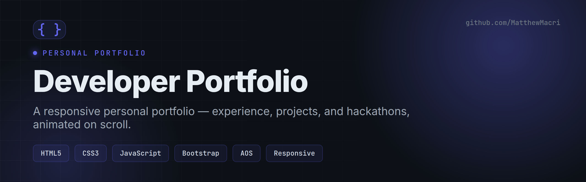
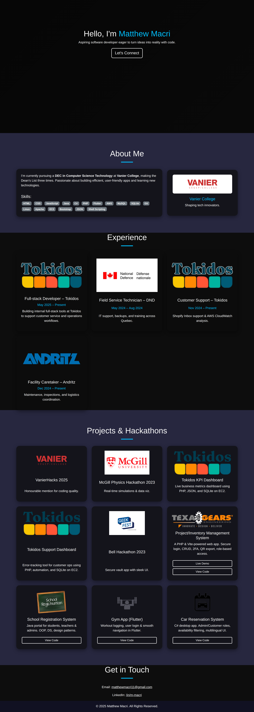

# Developer Portfolio

> A responsive personal portfolio site showcasing my experience, projects, and hackathons — with a clean dark theme and scroll animations.


---

## Overview

A single-page portfolio built with vanilla HTML, CSS, and JavaScript on top of Bootstrap 5. It presents who I am, where I've worked, and what I've built — responsive across phone, tablet, and desktop, with content that animates in as you scroll.

## Preview



## Features

- **Fully responsive** layout that adapts from mobile to widescreen
- **Dark, modern theme** with accent highlights
- **Scroll animations** via the AOS (Animate On Scroll) library
- **Sections** for About, Experience, Projects & Hackathons, and Contact
- **Experience timeline** with role cards (Tokidos, Department of National Defence, Andritz)
- **Project grid** linking to live demos and source repositories
- **SEO basics** — `sitemap.xml`, `robots.txt`, and semantic markup

## Tech Stack

| Layer | Tools |
|-------|-------|
| Markup & Style | HTML5, CSS3, Bootstrap 5.3 |
| Interactivity | Vanilla JavaScript |
| Animation | AOS (Animate On Scroll) |
| Tooling | Static site — no build step required |

## Getting Started

Clone the repo and open it directly, or serve it locally for the best experience:

```bash
git clone https://github.com/MatthewMacri/Portfolio-Website-Project.git
cd Portfolio-Website-Project

# Option 1 — open index.html in your browser
# Option 2 — serve locally
python3 -m http.server 8000   # then visit http://localhost:8000
```

## Project Structure

```
.
├── index.html      # Main portfolio page
├── style.css       # Custom styling
├── script.js       # Interactivity
├── assets/         # Images, logos, and previews
├── sitemap.xml     # SEO
└── robots.txt
```

## Author

**Matthew Macri** — Computer Science student at Vanier College
[LinkedIn](https://www.linkedin.com/in/m-macri/) · [GitHub](https://github.com/MatthewMacri) · matthewmacri11@gmail.com

## License

Released under the [MIT License](LICENSE).
